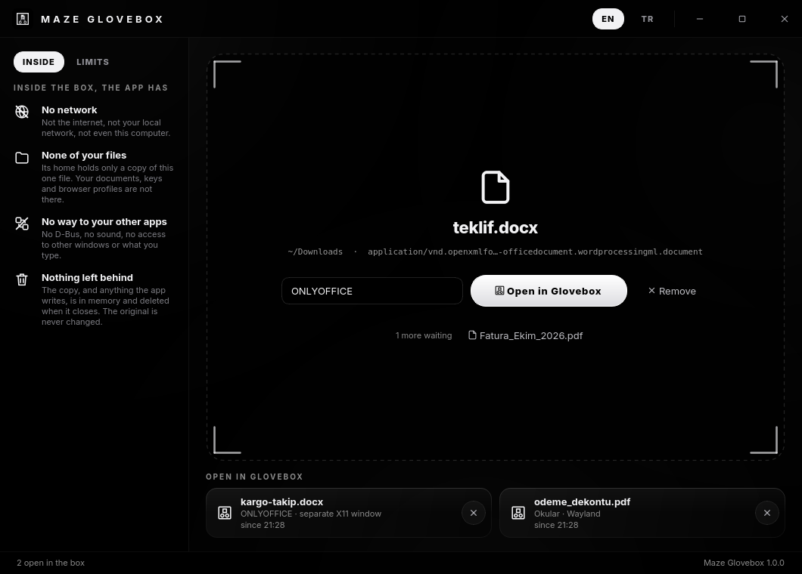
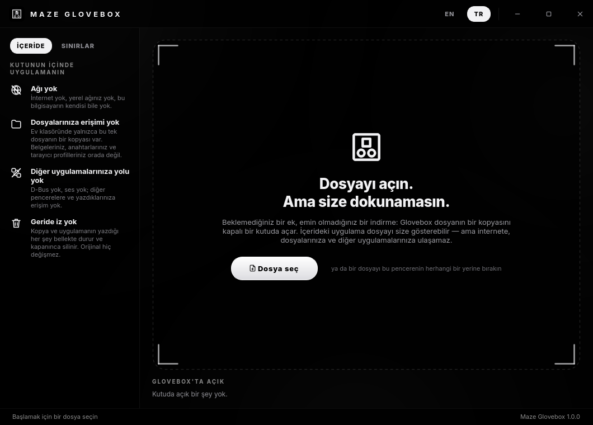

<div align="center">


# Maze Glovebox

**Open the file. Keep it at arm's length.**

*Open suspicious files in a sealed box — for Maze Linux*

</div>

---



An attachment you did not expect, a PDF from a site you do not trust, a document someone insists you open: Maze Glovebox opens a **copy** of it, with the app you would normally use, inside a box. The app can show you the file. It cannot reach the internet, your files, or your other apps — and when you close it, the box and everything in it are gone.

## What the app inside the box has

| | |
|---|---|
| **No network** | A network namespace of its own with no interface: not the internet, not your LAN, not even this computer's loopback. A document that tries to "phone home" — tracking pixels, exploit second stages — has nowhere to go. |
| **None of your files** | Its home folder holds only the copy of this one file, on tmpfs. Your documents, SSH keys, browser profiles and other files do not exist inside. The system (`/usr`, `/opt`) is there read-only, so the app runs and can change nothing. Of `/etc` it sees only what programs need to start and look right; it never sees your user name, the machine ID or which VPN, Tor, wallet and Maze tools you run. It gets a made-up user, hostname and a fresh machine ID for every box. |
| **No way to your other apps** | No session or system D-Bus, no sound, no GPU, no real X server, no capabilities, its own process list. It also cannot hand the file to a copy of the app already open outside the box. |
| **Nothing left behind** | The copy and anything the app writes live in memory and are deleted when the app closes. The original is read once and never changed. |

Only the Wayland socket goes in, so a window can appear. Unlike X11, Wayland does not let one app read another app's windows or keystrokes.

**Apps that only speak X11** (ONLYOFFICE, some older or Electron apps) are detected automatically and get **an X server of their own** — a separate Xwayland window started inside the same box — instead of your desktop's, which would let them see every window and every key press.

| | |
|---|---|
|  | |

## How to use it

- **Dolphin:** right-click any file → **Open in Glovebox**. It opens with your usual app for that type.
- **The window:** choose or drop a file, pick the app from the list, **Open in Glovebox**. The list shows what is open in the box, with **Close**.
- **Command line:**

  ```bash
  maze-glovebox report.pdf          # the window, with the file ready
  maze-glovebox --open report.pdf   # open right away with the default app
  maze-glovebox --list              # what is open in the box
  maze-glovebox --close ID
  ```

Apps installed as Flatpak or Snap, or outside `/usr` and `/opt`, cannot run inside the box and are listed as such.

## What the box cannot do

Said up front, and in the app:

- It protects your computer **from the file**, not you from **what the file says**: a fake invoice or a phishing link is still one.
- What you copy inside the box can be pasted outside it — do not paste links or commands from a suspicious file.
- Changes made inside the box are thrown away.
- A box shares the Linux kernel with your system. It stops malicious documents and the bugs of the apps that open them; it is not a virtual machine, and a kernel exploit is out of its reach.

## Install

On Maze Linux:

```bash
sudo pacman -S maze-glovebox
```

### Build from source

```bash
./build-pkg.sh
sudo pacman -U dist-pkg/maze-glovebox-*-any.pkg.tar.zst
```

The script runs the tests, builds the package and stops; it never installs and never asks for a password.

## How it works

Every box is an unprivileged [bubblewrap](https://github.com/containers/bubblewrap) sandbox (`--unshare-all --cap-drop ALL --new-session --die-with-parent`), started as you — no root, no service. Each opened file is a session of its own (`maze-glovebox --run`), so it keeps running if the window is closed; sessions list themselves in `$XDG_RUNTIME_DIR/maze-glovebox/sessions`, and an entry is only trusted while the process with that pid *and* that start time exists.

An app that exits within seconds complaining that it cannot open a display is restarted once in X11 mode (`mazeglovebox/core/x11run.sh`).

## Tests

```bash
/opt/maze/venv/bin/python3 -m unittest discover -s tests -v
```

The tests start real boxes and check from inside that there is no network, no real home, no D-Bus, no capabilities and no host processes; that a session copies, runs and deletes; that the original is never changed; and that an X11-only app is retried in its own X window. No window is opened.

## License

Copyright © 2026 Berk Küçük — GPL3, see [LICENSE](LICENSE).
